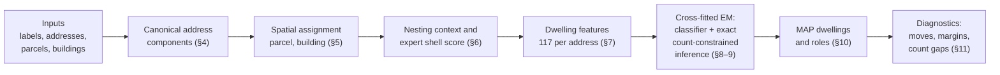

# Technical report: shell identification and the count-constrained dwelling model

This report sets out how the pipeline turns addresses, parcels, buildings and PD (private dwelling) labels into a dwelling decision and a role for every address. It covers each stage's definitions, the probability model, how the model is fitted and why, what has been validated, and the limits.

For how to run it and read its outputs, see the [run guide](run_guide.md).

**Contents**

1. [Summary](#1-summary)
2. [Problem and notation](#2-problem-and-notation)
3. [Pipeline overview](#3-pipeline-overview)
4. [Address canonicalisation and nesting](#4-address-canonicalisation-and-nesting)
5. [Spatial assignment](#5-spatial-assignment)
6. [Context features and the expert shell score](#6-context-features-and-the-expert-shell-score)
7. [Dwelling features](#7-dwelling-features)
8. [The count-constrained misplacement model](#8-the-count-constrained-misplacement-model)
9. [Learning: cross-fitted EM](#9-learning-cross-fitted-em)
10. [Roles: dwellings and shells](#10-roles-dwellings-and-shells)
11. [Diagnostics](#11-diagnostics)
12. [Prediction without labels](#12-prediction-without-labels)
13. [Validation](#13-validation)
14. [Computational cost](#14-computational-cost)
15. [Assumptions and limitations](#15-assumptions-and-limitations)

Appendices:
- [A. Expert shell features and weights](#appendix-a-expert-shell-features-and-weights)
- [B. Dwelling feature list](#appendix-b-dwelling-feature-list)
- [C. Default parameters](#appendix-c-default-parameters)

---

## 1. Summary

Each parcel has a known number of private dwellings: its number of PD labels. The labels themselves are sometimes on the wrong address of the parcel. Typically the label sits on a unit block's street address instead of a unit, or on `10` instead of `10B`. The task is to keep each parcel's count and decide which of its addresses are the dwellings.

The method has four parts:

1. **Describe every address against its parcel.** This yields 117 numeric features: address structure, geocode placement, buildings, how addresses nest under each other, and a transparent expert "shell" score.
2. **Combine a classifier with a misplacement model.** A gradient-boosted classifier gives each address a probability of being a dwelling. A misplacement model for the labels combines it with the count. Under that model, the probability of every possible choice of *K* dwellings on a parcel is computed **exactly** with Poisson–binomial recursions, with no sampling or approximation.
3. **Learn by expectation–maximisation (EM).** The classifier is refitted to the posterior probabilities, and the rate of misplaced labels is re-estimated from the data. The classifier is **cross-fitted** by parcel: a parcel's probabilities always come from a model that never saw that parcel's labels, so labels can't simply confirm themselves.
4. **Assign roles.** The most probable choice of dwellings is fixed, and roles are read off the nesting graph. A non-dwelling address that dwellings nest under is a *shell*; the top one on a parcel is its *primary shell*.

On synthetic data with known truth, with 4.5% of labels on the wrong address:
- In the minimal four-input layout, it corrected 176 of 180 misplaced labels, changed no correct label, and found every shell. The 4 it missed are corner lots whose two street addresses can't be told apart.
- With building heights and the full G-NAF fields, it corrected all 180.

Synthetic results are optimistic by construction (section 13). Accuracy on real data must be measured by hand-checking a sample.

---

## 2. Problem and notation

| Symbol | Meaning |
|---|---|
| $p$ | a parcel (base cadastral parcel, keyed by `parcel_id`) |
| $i = 1, \dots, n$ | the addresses on parcel $p$ |
| $x_i$ | the feature vector of address $i$ |
| $z_i \in \lbrace 0, 1 \rbrace$ | hidden truth: 1 if address $i$ is a private dwelling |
| $\ell_i \in \lbrace 0, 1 \rbrace$ | the label: 1 if address $i$ is flagged PD |
| $K$ | the parcel's dwelling count, $K = \sum_i \ell_i$ (or a supplied trusted count) |
| $A$, $B$ | the labelled addresses ($\ell_i = 1$, $\lvert A \rvert = L$) and the rest ($\lvert B \rvert = n - L$) |
| $f_i$, $\eta_i$ | the classifier's dwelling probability for $i$, and its logit $\eta_i = \log \frac{f_i}{1 - f_i}$ |
| $q_i$ | the posterior dwelling probability, $P(z_i = 1 \mid \text{labels}, K, x)$ |
| $u$, $v$ | the number of labelled non-dwellings, $\lvert \lbrace i \in A : z_i = 0 \rbrace \rvert$, and of unlabelled dwellings, $\lvert \lbrace j \in B : z_j = 1 \rbrace \rvert$ |
| $m$ | the number of misplacements, $m = \min(u, v)$ |
| $\pi(m)$ | the prior probability of $m$ misplaced labels on a parcel, $m = 0, \dots, M$ with $M = 3$ |

**Label semantics.** An address is labelled PD when it appears in `labelled_asset` with a true flag. Every other address is $\ell_i = 0$. So the count $K$ is known for every parcel, including $K = 0$.

**Goal.** Find $z$ with $\sum_{i \in p} z_i = K$ on every parcel, the most probable given the labels and features. Report the per-address posteriors $q_i$, and a role for every address.

---

## 3. Pipeline overview

All tabular work runs in polars (joins and group-bys), and geometry in vectorised shapely. Distances and areas are computed in an equal-area metric CRS: Australian Albers, EPSG:9473 for GDA2020 or EPSG:3577 for GDA94.

---

## 4. Address canonicalisation and nesting

### 4.1 Components

Each address is reduced to:

- **`street_key`:** street name, type and suffix, locality and state, with types normalised (`STREET`→`ST`).
- **`num_key`:** the full street number, e.g. `25A` or `1-15` for a range. `LOT n` when there is only a lot number.
- **`base_num_key`:** the number without its suffix (`25` for `25A`).
- **Three optional sub-address components**, from least to most specific:
  - $c^{S}$ structure (`TOWER A`, `BUILDING 2`)
  - $c^{L}$ level (`L:3`)
  - $c^{F}$ flat (`UNIT:5`)

A building name is split into a structural id and a *vanity* name. In `THE QUAY TOWER A`, the structure is `TOWER A` and the vanity name is `THE QUAY`. Where one street number holds two or more vanity names (`THE ASH`, `THE BIRCH`), the names are promoted to structures, because they identify separate buildings.

The component **mask** is a 3-bit code: structure = 4, level = 2, flat = 1. For example, `UNIT 5, LEVEL 2` has mask 3. **Specificity** is the number of components present. The **node type** is:
- the flat type's category (`dwelling`, `commercial`, `ancillary`, `secondary`) when a flat component exists;
- else `level` if a level exists;
- else `structure` if a structure exists;
- else `street`.

### 4.2 Nesting

Address $b$ **nests in** address $a$ when all three hold:
- they share parcel, `street_key` and `num_key`;
- every component $a$ has is equal in $b$;
- $b$ has at least one component $a$ lacks.

In mask terms, $\text{mask}(a) \subset \text{mask}(b)$ strictly, with equal values on $\text{mask}(a)$. Only masks without the flat bit can contain others: a flat is never a container.

Four further relations extend nesting:

| Relation | Definition |
|---|---|
| **Range containment** | A range address $[a_1, a_2]$ covers every address on the same parcel and street whose number lies in $[a_1, a_2]$ and whose components are compatible. The covered address's range parent is the narrowest covering range. |
| **Suffix siblings** | `100A`, `100B` are siblings of an unsuffixed `100` on the same parcel and street. |
| **Off-parcel children** | Sub-addresses of the same street address (same `street_key` and `num_key`) geocoded onto a *different* parcel within 150 m. |
| **Parent** | The most specific context address an address nests in, else its range parent. |

The **context set** of a parcel is its principal (non-alias) addresses. Every address is described against that set.

---

## 5. Spatial assignment

**Parcel.** Each geocode is assigned to:
- the smallest base parcel containing it; or else
- the nearest base parcel within $d_{\text{snap}} = 5$ m; or else
- none.

`parcel_match` records which. Polygons sharing a `parcel_id` are one parcel; their geometry is unioned where a single shape is needed.

**Building.** Each geocode is assigned to:
- the smallest building footprint containing it; or else
- the building-address link table, where supplied (confidence ≥ 50, primary building first).

**Building to parcel.** Each building belongs to the parcel named in the building-cadastre link table where that is a base parcel, otherwise to the parcel containing a point on its surface.

**Parcel context.** For each parcel:
- area;
- strata counts (where supplied);
- number of buildings;
- number of *dwelling-size* buildings (footprint ≥ 35 m²);
- tallest building, by estimated storeys:

$$
\text{levels} = \begin{cases} \operatorname{round}\left( F / A \right) & \text{if floor area } F \text{ and footprint area } A \text{ are known} \\ \operatorname{round}\left( H / 3.1 \right) & \text{else, if roof height } H \text{ is known} \end{cases} \qquad \text{clipped to} \ge 1 .
$$

**Stacking.** Geocodes are snapped to a 0.5 m grid. Addresses in the same cell on the same parcel are *stacked*, meaning they share a point.

---

## 6. Context features and the expert shell score

### 6.1 Context counts

For each address $a$, against its parcel's context set:

- **$n_{\text{desc}}(a)$:** addresses nesting in $a$.
- **$\text{eff}_{\text{desc}}(a)$:** the same, weighted by node type. The weight is 1 for dwelling, commercial, level and structure; 0.5 for secondary; 0.25 for ancillary.
- **The same counts per node type**, and **stacked children**: those sharing $a$'s geocode.
- **Range children:** addresses covered by $a$'s range, counted the same way.
- **Off-parcel children:** as defined in 4.2.
- **Number of suffix variants:** for unsuffixed bare addresses.
- **Parcel counts:**
  - other addresses on the parcel;
  - other streets;
  - addresses in the same building;
  - other addresses inside buildings;
  - other addresses with building- or unit-level geocodes;
  - **other dwellings**: the occupiable leaves competing with $a$, meaning addresses with nothing nested beneath them that share $a$'s street and base number, plus those its range covers.

An address is a **shell candidate** if it has weighted children, range children, suffix siblings (as the unsuffixed base) or off-parcel children.

### 6.2 Expert score

The shell identifier scores how *shell-like* each address is with a transparent logistic model over 30 readable features $g_{ik}$ (Appendix A):

$$
s_i = b + \sum_{k} w_k\, g_{ik}, \qquad P(\text{shell}_i) = \sigma(s_i) = \frac{1}{1 + e^{-s_i}} .
$$

- **Weights:** expert defaults, with $b = -1$. Positive weights push towards "shell".
- **Classes:** probability bands $\ge 0.8$ `SHELL`, $\ge 0.6$ `LIKELY_SHELL`, $\ge 0.4$ `UNCERTAIN`, $\ge 0.2$ `LIKELY_NOT_SHELL`, else `NOT_SHELL`.
- **`reasons`:** the four largest contributions $\lvert w_k g_{ik} \rvert$, each written with its signed contribution $w_k g_{ik}$.

The weights can optionally be refitted from shell labels $y_i$, anchored to the defaults $w^{0}$:

$$
\min_{b, w} \; \sum_i \left[ \log\left(1 + e^{s_i}\right) - y_i s_i \right] + \lambda \lVert w - w^{0} \rVert^2 + 0.01\, (b - b^{0})^2 ,
$$

so weights move only where the labels give evidence. The logit $s_i$ and all 30 features also enter the dwelling model (`x_shell_logit`, `f_*`).

---

## 7. Dwelling features

Each address gets 117 features in seven families (full list in Appendix B):

| Family | Count | Content |
|---|---|---|
| `t_` address text | 22 | Node type one-hots; has flat / level / structure / vanity name; range; suffix; lot only; unknown flat type; flat and level numbers; flat ≥ 100; ground / basement level; flat number matches level ($\lfloor \text{flat}/100 \rfloor = \text{level}$, as in unit 203 on level 2) |
| `g_` geocode placement | 16 | Geocode category (parcel / building / unit / other); distance to the parcel centroid and to its boundary, both divided by $\sqrt{\text{parcel area}}$; boundary distance in metres; stack size ($\log(1 + \cdot)$) and share of the parcel; at the parcel's most common point; inside a building; building by link; snapped to parcel; no parcel; distance to the nearest building (capped at 100 m) |
| `b_` the address's building | 6 | Footprint area (log); storeys; addresses in the building; area per address (log); residential / commercial use |
| `p_` parcel buildings | 5 | Building coverage; floor area (log), total and per address; addresses per dwelling-size building; share of commercial floor area |
| `c_` parcel composition | 5 | Addresses on the parcel (log); share with a flat component; number of bare street addresses; is the only bare address; specificity rank within the parcel |
| `x_` nesting context | 33 | The counts of 6.1, parcel and strata context, G-NAF primary / secondary flags, and the expert logit $s_i$ |
| `f_` expert features | 30 | The features of the expert score (Appendix A) |

**Missing values.** A feature the inputs can't supply, such as storeys without heights, is *missing*, not zero. The classifier handles missing values natively: at each split, missing values go to whichever side fits better. Not-a-number and infinite values are treated as missing.

A feature with no usable value on the training addresses is removed before fitting, and the removal is logged. A feature too sparse to survive the classifier's binning sample is held constant for that fit (9.4).

---

## 8. The count-constrained misplacement model

This is the core of the method. Take one parcel with $n$ addresses, count $K$, labelled set $A$ ($\lvert A \rvert = L$) and the rest $B$.

### 8.1 The classifier

A single classifier is shared by all parcels:

$$
f_i = P(z_i = 1 \mid x_i), \qquad \eta_i = \operatorname{logit} f_i .
$$

On its own, it treats the $z_i$ as independent Bernoulli variables.

### 8.2 The label model

The labeller knew how many dwellings the parcel has, but may have put some labels on the wrong address. A configuration $z$ with $\sum_i z_i = K$ implies:
- $u$ labelled addresses that are not dwellings;
- $v$ unlabelled addresses that are dwellings.

These satisfy $v - u = K - L$; when $K = L$, $u = v$. The number of misplacements is $m = \min(u, v)$.

The label model puts prior mass $\pi(m)$ on $m$, and spreads it **uniformly over the ways of choosing which** labels are misplaced and where they went:

$$
P(\text{labels} \mid z) \;\propto\; \frac{\pi(m)}{\binom{L}{u} \binom{n-L}{v}} .
$$

Combining with the classifier and the count gives the posterior over configurations:

$$
P(z \mid \text{labels}, K, x) \;\propto\; \mathbb{1}\left[ \textstyle\sum_i z_i = K \right] \; \prod_{i=1}^{n} f_i^{\,z_i} (1 - f_i)^{1 - z_i} \; \frac{\pi\left( \min(u, v) \right)}{\binom{L}{u} \binom{n - L}{v}} .
$$

**Why not independent label noise?** The usual alternative flips each label independently with rate $\varepsilon$. That gives $P(\text{labels} \mid z) \propto \varepsilon^{u+v} (1 - \varepsilon)^{n - u - v}$. A single misplacement (one label moved, $u = v = 1$) then costs $\varepsilon^2$: it is treated as *two* independent errors, and is heavily over-penalised. Independent noise also makes no use of the count being right.

The misplacement model prices a move as one event, $\pi(1)$. The binomial normaliser makes all ways of misplacing $m$ labels equally likely, so a large parcel isn't favoured merely because it offers more ways to misplace.

### 8.3 Exact posterior by Poisson–binomial recursion

The sum over all $\binom{n}{K}$ configurations factorises by $(u, v)$. Fix $(u, v)$. The classifier term summed over all configurations with those values is:

$$
\sum_{z : (u,v)} \prod_i f_i^{z_i} (1-f_i)^{1-z_i} = D_A(u)\, D_B(v) ,
$$

where

$$
D_A(u) = \sum_{S \subseteq A,\, \lvert S \rvert = u} \; \prod_{i \in S} (1 - f_i) \prod_{i \in A \setminus S} f_i ,
\qquad
D_B(v) = \sum_{T \subseteq B,\, \lvert T \rvert = v} \; \prod_{j \in T} f_j \prod_{j \in B \setminus T} (1 - f_j) .
$$

$D_A(u)$ is the probability that exactly $u$ of the labelled addresses are non-dwellings. $D_B(v)$ is the probability that exactly $v$ of the others are dwellings. Both are Poisson–binomial probabilities.

The feasible pairs are:

$$
\mathcal{F} = \left\lbrace (u, v) : v = u + K - L,\; 0 \le u \le L,\; 0 \le v \le n - L,\; \min(u, v) \le M \right\rbrace .
$$

Each pair has weight

$$
\omega(u, v) = \frac{\pi(\min(u,v))}{\binom{L}{u}\binom{n-L}{v}}\, D_A(u)\, D_B(v), \qquad Z = \sum_{(u,v) \in \mathcal{F}} \omega(u, v) .
$$

**Recursion.** $D$ is computed by a forward recursion over the items, truncated at the largest count needed. With hit probability $h_j$ ($1 - f_j$ for $A$, $f_j$ for $B$):

$$
F_0(0) = 1, \qquad F_j(c) = F_{j-1}(c)\, (1 - h_j) + F_{j-1}(c-1)\, h_j .
$$

**Marginals.** These need the same quantity with one item removed. It comes from a forward pass $F$ and a backward pass $G$:

$$
D_{\setminus i}(c) = \sum_{a=0}^{c} F_{i-1}(a)\, G_{i+1}(c - a) .
$$

The posterior marginals are then

$$
P(z_i = 0) = \frac{1}{Z} \sum_{\substack{(u,v) \in \mathcal{F} \\ u \ge 1}} \frac{\pi(\min(u,v))}{\binom{L}{u}\binom{n-L}{v}}\, (1 - f_i)\, D_{A \setminus i}(u - 1)\, D_B(v) \qquad (i \in A),
$$

$$
P(z_j = 1) = \frac{1}{Z} \sum_{\substack{(u,v) \in \mathcal{F} \\ v \ge 1}} \frac{\pi(\min(u,v))}{\binom{L}{u}\binom{n-L}{v}}\, D_A(u)\, f_j\, D_{B \setminus j}(v - 1) \qquad (j \in B),
$$

giving $q_i = 1 - P(z_i = 0)$ for $i \in A$ and $q_j = P(z_j = 1)$ for $j \in B$. The parcel's posterior over the number of misplacements is

$$
P(m \mid \cdot) = \frac{1}{Z} \sum_{(u,v) \in \mathcal{F},\, \min(u,v) = m} \omega(u, v) .
$$

**Implementation details.**
- **Log space:** everything is computed in log space with log-sum-exp, so very confident probabilities don't underflow.
- **Cost:** for one parcel it is $O(n\, c_{\max}^2)$, where $c_{\max} \le M + \lvert K - L \rvert$. With label-derived counts ($K = L$), $c_{\max} \le 3$, so the cost is linear in $n$.
- **Special cases:**
  - Parcels with $K = 0$ or $K = n$ have a fixed answer (no dwellings, or all dwellings) and are skipped.
  - If $\mathcal{F}$ is empty, the labels are too far from the count to be explained by at most $M$ misplacements. This can only happen with supplied counts. The labels are then ignored and $q_i = P(z_i = 1 \mid \sum z = K)$ (section 12).

**Check.** The posterior marginals and the MAP (8.4) agree with brute-force enumeration over all $2^n$ configurations to within $10^{-10}$, on 25 random parcels with $n \le 7$ (`tests/test_dwellings.py`).

### 8.4 The most probable configuration (MAP)

Write the log-posterior relative to "every label correct":
- Dropping a label from $i \in A$ adds $\log(1 - f_i) - \log f_i = -\eta_i$.
- Adding a dwelling $j \in B$ adds $\eta_j$.

For fixed $(u, v)$, the best configuration therefore drops the $u$ labelled addresses with the **smallest** $\eta$ and adds the $v$ unlabelled addresses with the **largest** $\eta$:

$$
\operatorname{score}(u, v) = \log \pi(\min(u,v)) - \log \binom{L}{u} - \log \binom{n-L}{v} + \sum_{r=1}^{u} \left( -\eta_{A,(r)} \right) + \sum_{r=1}^{v} \eta_{B,[r]} ,
$$

where $\eta_{A,(r)}$ is the $r$-th smallest logit in $A$ and $\eta_{B,[r]}$ the $r$-th largest in $B$. The MAP is the best of these scores over $\mathcal{F}$. This is exact, and costs a sort per parcel.

The model's decision `assigned_dwelling` is this MAP, so every parcel gets exactly $K$ dwellings. The marginals $q_i$ (`posterior`) report how certain each address is.

---

## 9. Learning: cross-fitted EM

The classifier $f$ and the prior $\pi$ are unknown, and are learned by expectation–maximisation over all parcels.

### 9.1 Steps

1. **Initialise.** Set every $\eta_i$ to the logit of the share of PD labels (clipped to $[0.01, 0.99]$), and compute the first posteriors $q$.
2. **M-step (classifier).** Fit the classifier to the soft targets $q$, maximising the expected log-likelihood

   $$
   \sum_i w_i \left[ q_i \log f(x_i) + (1 - q_i) \log\left(1 - f(x_i)\right) \right] .
   $$

   In practice, a row with $q_i \le 0.01$ or $q_i \ge 0.99$ enters once with a hard label. Any other row enters twice: as a dwelling with weight $w_i q_i$, and as a non-dwelling with weight $w_i (1 - q_i)$.
3. **Cross-fitting.** Parcels are split into 5 folds (grouped by parcel). For each fold, the classifier is fitted on the other folds and predicts this one. Every $f_i$ therefore comes from a model that never saw address $i$'s parcel.
4. **E-step.** Compute $q$ and each parcel's $P(m \mid \cdot)$ exactly (8.3), using the current $\pi$.
5. **M-step (prior).** Re-estimate $\pi$ from the parcels where a misplacement is possible: $0 < K < n$, with both labelled and unlabelled addresses. Call this set $\mathcal{P}_{\text{mix}}$. The estimate is smoothed towards the starting prior $\pi_0$ with $\alpha = 50$ pseudo-counts:

   $$
   \hat\pi(m) \;\propto\; \sum_{p \in \mathcal{P}_{\text{mix}}} P_p(m \mid \cdot) + \alpha\, \pi_0(m), \qquad \pi_0 = (0.75,\, 0.18,\, 0.05,\, 0.02) .
   $$

6. **Assign.** Compute the MAP (8.4) with the updated $\pi$, and count the addresses whose assignment changed.
7. **Repeat** from step 2. Stop after at least two rounds once at most $0.05\%$ of addresses change, or after 8 rounds.
8. **Final model.** One more classifier is fitted on all parcels with the final $q$. It is used only for addresses outside every parcel and for applying the model elsewhere (section 12). Reported probabilities on verified parcels are the cross-fitted ones.

The reported `dwelling_prob` is the cross-fitted $f_i$, `posterior` is $q_i$, and `assigned_dwelling` is the MAP.

### 9.2 Why cross-fit

Without cross-fitting, the classifier is trained on a parcel's own labels and then asked whether those labels are right. A flexible classifier can memorise a misplaced label, and the label never moves.

With cross-fitting, address $i$'s probability reflects only what the *other* parcels say an address like $i$ is. A label is moved when the pattern across the rest of the data, such as "a street address over 8 stacked units is not a dwelling", outweighs the prior belief that labels are right.

Strictly, the separation holds within a round. Across rounds, the targets of the training folds were computed with models that had seen the held-out fold. That indirect second-order path is weak, and the direct one (a parcel's labels shaping its own $f$) is closed.

### 9.3 Fixed answers and weighting

Single-address parcels have a fixed answer ($z = K \in \lbrace 0, 1 \rbrace$) but are numerous. A random 25% of them are used for training, weighted $1/0.25 = 4$ (inverse-probability weighting): this keeps the fit unbiased in expectation at lower cost. Other fixed parcels ($K = 0$ or $K = n$) are used in full. The EM never re-solves any of them.

### 9.4 The classifier

The classifier is a histogram gradient-boosted tree ensemble (scikit-learn `HistGradientBoostingClassifier`):
- 150 boosting rounds, learning rate 0.1;
- at most 31 leaves per tree, at least 20 samples per leaf;
- L2 penalty 1.0;
- no early stopping, fixed random seed;
- native missing-value handling.

Trees suit the data: they handle missing values, mixed scales, counts and interactions (a flat component *and* a stacked geocode) without hand-built transforms.

**Binning guard.** With more than 200,000 training rows, scikit-learn picks each feature's bin edges from a 200,000-row sample drawn in proportion to the sample weights. In scikit-learn 1.9, a feature with no value in that sample makes the fit fail. So, for each fit, any feature whose expected number of sampled values is below 30 is held constant: no tree splits on it, and its values are ignored when predicting. That is, the guard applies when

$$
200{,}000 \times \frac{\sum_{i:\, x_{ik} \text{ known}} w_i}{\sum_i w_i} < 30 .
$$

The chance such a feature would vanish from the sample is about $e^{-30}$ at the threshold, and higher below it. A feature this sparse (under 0.015% of the weighted rows) carries almost no information anyway.

**Determinism.** Folds, the subsample and the trees all use fixed seeds, so the same inputs give the same output.

### 9.5 Convergence

The EM alternates between refitting trees and solving each parcel exactly. Because the folds' models change between rounds, the objective is not guaranteed to increase every round. A handful of near-tied addresses can flip back and forth: on synthetic data, about 10 of 3,985 at rounds 4–8. The stopping rule and the round limit bound this. The flips concern addresses whose posteriors are close, and the diagnostics flag them (section 11).

---

## 10. Roles: dwellings and shells

Given the MAP dwellings $z$, roles come from a parent graph. Each address's parent is:
- its nesting or range parent (section 4);
- else, for a suffixed number (`100A`), the bare unsuffixed address on the same parcel and street (`100`);
- else, for a sub-address with no parent, the unique bare street address with the same street and number when it lies on a *different* parcel (a geocode slip).

For each address $a$, let $\operatorname{below}(a)$ be the number of dwellings whose chain of parents (up to 6 levels) passes through $a$. Then

$$
\operatorname{container}(a) = \operatorname{below}(a) > 0 \;\wedge\; z_a = 0 \;\wedge\; \left( \operatorname{below}(a) \ge 2 \;\vee\; P(\text{shell}_a) \ge 0.5 \right) .
$$

The last condition separates a shell from an occupancy. A shop with one flat beside it (`70` / `70A`) has one dwelling below and doesn't look shell-like on the expert score, so it is not a container.

| Role | Condition |
|---|---|
| `DWELLING` | $z_a = 1$ |
| `PRIMARY_SHELL` | a container with no container among its ancestors |
| `SUB_SHELL` | a container with a container ancestor (a tower or level inside a complex) |
| `OUT_OF_SCOPE` | anything else |

`primary_shell_pid` is the primary shell found by walking up from each address. `dwellings_below` is $\operatorname{below}(a)$.

---

## 11. Diagnostics

| Output | Definition | Use |
|---|---|---|
| `label_change` | `PD->OOS` where $\ell_i = 1, z_i = 0$; `OOS->PD` where $\ell_i = 0, z_i = 1$ | The corrections |
| moves | Within a parcel, removed labels sorted by $q$ ascending are paired with added dwellings sorted by $q$ descending | One row per moved label |
| `confidence` | $q_{\text{to}} - q_{\text{from}}$ for a move | 1 is a clear swap; near 0 is a coin flip |
| `margin` | $\min_{i : z_i = 1} q_i - \max_{j : z_j = 0} q_j$ on a parcel | Near 1 is clear-cut; $< 0.3$ flags the parcel for review |
| `rank_in_parcel` | Rank of $q_i$ within the parcel (1 = most dwelling-like) | Explains the decision text |
| `expected_dwellings` | $\sum_{i \in p} f_i$: the count implied by the features alone | Count-error check (below) |
| importance | Drop in log-likelihood of the final model when one feature is permuted, on up to 8,000 verified addresses against the MAP targets (2 repeats) | Which features drive the model |

**Count-error check.** Ignoring the labels, the classifier implies $\sum_i z_i$ is Poisson–binomial, with mean $\sum_i f_i$ and variance $\sum_i f_i (1 - f_i)$. A parcel whose $K$ is far from $\sum_i f_i$ is one where the count, not the choice of address, may be wrong. The model takes $K$ as given and can't correct that itself. A positive gap $\sum_i f_i - K$ suggests unlabelled dwellings; a negative one suggests surplus labels.

---

## 12. Prediction without labels

The final classifier can be applied to an area without labels:

- **Without counts:** $z_i = \mathbb{1}[f_i \ge 0.5]$, with no constraint between addresses.
- **With a trusted count $K$ for a parcel:** the label term drops out, and

  $$
  q_i = P\left(z_i = 1 \,\middle|\, \textstyle\sum_j z_j = K\right) = \frac{f_i \; P\left( \sum_{j \ne i} z_j = K - 1 \right)}{P\left( \sum_j z_j = K \right)} ,
  $$

  computed with the same recursions. The MAP under the count is the $K$ addresses with the largest $\eta_i$.

Roles follow as in section 10.

---

## 13. Validation

### 13.1 What is tested

- **Exact inference:** posterior marginals and MAP match brute-force enumeration on random parcels (8.3).
- **Counts:** conditional marginals sum to the count.
- **End-to-end synthetic runs** in three ways in: files, a datasets YAML, and LazyFrames. Each must fix at least 60–80% of misplaced labels, change at most 1–2% of addresses wrongly, and reach shell precision and recall above 0.95.
- **Equivalence:** the polars implementation reproduces the earlier pandas implementation exactly (features, probabilities, EM history, assignments), and the PD-only label input reproduces the earlier PD/OOS input exactly.

### 13.2 Synthetic study

**Data.** The synthetic generator builds a town: in this run, 702 parcels and 3,985 addresses.
- **Site types:** 18 kinds, including houses, duplexes with a shell street address, walk-ups, towers, townhouses, number ranges, shop-tops, mixed use, offices, retirement villages and corner lots.
- **Footprints and geocodes:** each site gets realistic building footprints and geocodes, including stacked unit geocodes and geocodes that slip onto the neighbouring parcel.
- **Labels:** every site has the right number of PD labels. On each eligible site, with probability 0.3 one PD label is moved to a non-dwelling on the same site, and with probability 0.25 a second attempt follows. When the site has a shell, 70% of moves go to it.

This run had 3,197 true dwellings and 180 misplaced labels: 90 moves, each leaving one address wrongly PD and one wrongly not. That is 4.5% of addresses wrong, on 12.8% of parcels.

**Results**, default settings:

| Metric | Labels as given | Model, minimal layout | Model, full layout |
|---|---|---|---|
| Address accuracy | 0.9548 | 0.9990 | 1.0000 |
| Parcels with every address right | 0.8718 | 0.9972 | 1.0000 |
| Misplaced labels corrected | n/a | 176 / 180 | 180 / 180 |
| Correct labels made wrong | n/a | 0 | 0 |
| Shell precision / recall | n/a | 1.00 / 1.00 (273 shells) | 1.00 / 1.00 |
| Estimated $1 - \pi(0)$ | n/a | 0.303 | 0.308 |

The two layouts:
- **Minimal:** your four inputs only, with no building heights and no G-NAF primary/secondary, legal parcel or geocode type. 109 of 117 features were usable.
- **Full:** heights, the full G-NAF fields and strata; all 117 features usable.

**Remaining errors.** The 4 errors in the minimal layout are two **corner lots**. Each has two bare street addresses on two frontages, and the label was on the wrong frontage. Both addresses look the same to every feature, so $f$ is equal and the prior keeps the label. This is a limit of identifiability, not of fitting: no address-level evidence separates them.

**By site type** (minimal layout), every misplaced label was corrected for:
- duplexes (44 of 44);
- walk-ups (54 of 54);
- townhouses, number ranges and mixed use (50 of 50);
- shop-tops (10 of 10);
- towers and retirement villages (12 of 12).

### 13.3 How to read these numbers

The synthetic data follows the same assumptions as the model: right counts, misplacement within a site, and the error patterns the generator was told to make. So the figures show that the method works when its assumptions hold. They do **not** predict its accuracy on real data. Real data has errors the generator does not make, such as wrong counts, labels on another parcel, or geocodes far from their building.

To measure accuracy on real data, check a sample of moves by hand, stratified by `confidence` ([run guide §9.6](run_guide.md#96-how-often-are-the-moves-right)).

---

## 14. Computational cost

$N$ addresses, $P$ parcels, $F$ features, folds $k = 5$, rounds $T \le 8$.

| Stage | Cost |
|---|---|
| Components and context features | polars joins and group-bys, roughly $O(N \log N)$ |
| Spatial assignment | STRtree point-in-polygon and nearest queries, $O(N \log P)$ |
| E-step and MAP | $O(N)$ per round with label-derived counts; fixed parcels are skipped |
| Classifier | $k \cdot T + 1 = 41$ fits at most, each $O(N F)$ per boosting round after binning |
| Memory | The feature matrix holds $N \times F$ 8-byte floats, e.g. about 2.8 GB for 3 million addresses × 117 features, plus up to twice the uncertain rows during a fit |

For state-scale data, the main costs are the classifier fits and turning WKT into shapes for buildings. Running one region at a time bounds both.

---

## 15. Assumptions and limitations

1. **Counts are right.** Each parcel's number of PD labels is taken as its true number of dwellings. A wrong count is not corrected. It shows only as a gap between $K$ and $\sum f_i$ (section 11).
2. **Misplacement is within a parcel.** A label on the wrong parcel can't be moved. At most $M = 3$ misplacements per parcel are considered.
3. **All misplacement patterns of the same size are equally likely.** The model doesn't encode that labellers favour particular wrong addresses (such as the shell). That preference is learned from the data, through the classifier.
4. **One misplacement rate for every parcel.** $\pi(m)$ is shared by all parcels regardless of size or type.
5. **Most labels must be right for each kind of address.** The classifier learns what a dwelling looks like from the labels themselves. If labellers systematically put labels on street addresses *everywhere* for some kind of site, that habit becomes the learned pattern, and the model can't detect it. The method fixes errors that are the exception, not the rule.
6. **Unflagged means not PD.** The address table must cover exactly the labelled area. Otherwise unlabelled dwellings are read as non-dwellings, which biases both the counts and the classifier.
7. **Identical addresses can't be told apart.** Where two candidates have the same features (corner-lot frontages, identical stacked units with the same text pattern), the prior keeps the label as given.
8. **Missing inputs reduce evidence.** Without heights, building use, strata or G-NAF primary/secondary data, the corresponding features are unavailable. The model then relies more on address text and nesting.
9. **Parcels are keyed by `parcel_id`.** It must be unique within a run.
10. **Synthetic validation is optimistic** (13.3).

---

## Appendix A. Expert shell features and weights

Default log-odds weights ($b = -1$); positive values push towards "shell".

| Feature | Definition | Weight |
|---|---|---|
| `log_children` | $\log(1 + \text{eff}_{\text{desc}})$ | +2.2 |
| `single_child` | $0 < \text{eff}_{\text{desc}} \le 1.5$, no range children | −1.0 |
| `only_secondary_children` | children are secondary dwellings only | −2.0 |
| `only_ancillary_children` | children are car spaces / storage only | −2.0 |
| `log_range_children` | $\log(1 + \text{weighted range children})$ | +2.0 |
| `log_offparcel_children` | $\log(1 + \text{weighted off-parcel children})$ | +1.2 |
| `stacked_children` | share of children at the address's own point | +1.0 |
| `suffix_base` | unsuffixed number with suffixed siblings, no children | +0.4 |
| `suffix_multi_variant` | … with two or more suffix variants | +0.8 |
| `suffix_single_variant` | … with one suffix variant | −1.2 |
| `strata_matches_siblings` | small group, strata count ≤ other dwellings | +1.5 |
| `strata_exceeds_siblings` | small group, strata count > other dwellings | −2.0 |
| `building_surplus` | small group, more dwelling-size buildings than other dwellings | −0.8 |
| `building_deficit` | small group, 1 ≤ dwelling-size buildings ≤ other dwellings | +0.8 |
| `own_building` | candidate in a building no other address uses | −2.0 |
| `outside_buildings` | candidate outside every building while siblings are inside one | +0.7 |
| `multistorey` | candidate on a parcel with a building of 3 or more storeys | +1.0 |
| `vertical_strata` | candidate on a vertical strata scheme with 2 or more lots | +0.8 |
| `parcel_level_geocode` | candidate with a parcel-level geocode while siblings have building or unit geocodes | +0.4 |
| `gnaf_primary_linked` | G-NAF primary with linked secondaries | +2.0 |
| `gnaf_primary_flag_only` | G-NAF primary flag, no linked secondaries | +0.5 |
| `gnaf_secondary` | G-NAF secondary | −1.5 |
| `legal_common_property` | legal parcel id matches common property | +1.5 |
| `legal_strata_lot` | legal parcel id is a strata lot | −1.0 |
| `vanity_name` | candidate carrying a building or complex name, no flat | +0.3 |
| `leaf_subaddress` | sub-address that is not a candidate | −4.0 |
| `leaf_street_address` | street address that is not a candidate | −3.0 |
| `single_address_parcel` | only address on the parcel, no off-parcel children | −2.0 |
| `has_parent` | nests under another address | −0.5 |
| `alias` | G-NAF alias address | −1.5 |

A *small group* is a candidate with 1 to 6 other dwellings. In large complexes, one building more or less doesn't change the answer, so these balance checks apply only to small groups.

## Appendix B. Dwelling feature list

| Family | Features |
|---|---|
| `t_` (22) | `t_node_street`, `t_node_dwelling`, `t_node_commercial`, `t_node_ancillary`, `t_node_secondary`, `t_node_level`, `t_node_structure`, `t_has_flat`, `t_has_level`, `t_has_structure`, `t_has_vanity`, `t_is_range`, `t_has_suffix`, `t_lot_only`, `t_flat_type_unknown`, `t_flat_num`, `t_flat_num_ge100`, `t_flat_prefix`, `t_level_num`, `t_level_ground`, `t_level_basement`, `t_flat_matches_level` |
| `g_` (16) | `g_cat_parcel`, `g_cat_building`, `g_cat_unit`, `g_cat_other`, `g_cat_none`, `g_dist_centroid_rel`, `g_dist_edge_rel`, `g_dist_edge_m`, `g_stack_size`, `g_stack_share`, `g_at_modal_point`, `g_in_building`, `g_building_by_link`, `g_snapped`, `g_no_parcel`, `g_dist_building` |
| `b_` (6) | `b_area_log`, `b_levels`, `b_addr_count`, `b_area_per_addr_log`, `b_use_residential`, `b_use_commercial` |
| `p_` (5) | `p_building_coverage`, `p_floor_area_log`, `p_floor_area_per_addr_log`, `p_addr_per_dwelling_building`, `p_share_commercial_area` |
| `c_` (5) | `c_parcel_addresses_log`, `c_share_flats`, `c_n_bare`, `c_only_bare`, `c_specificity_rank` |
| `x_` (33) | `x_specificity`, `x_n_desc`, `x_eff_desc`, `x_n_desc_dwelling`, `x_n_desc_commercial`, `x_n_desc_ancillary`, `x_n_desc_secondary`, `x_n_desc_level`, `x_n_desc_structure`, `x_n_desc_stacked`, `x_n_desc_buildings`, `x_n_range_desc`, `x_n_range_numbers`, `x_n_offparcel_desc`, `x_n_suffix_variants`, `x_n_parcel_others`, `x_n_other_dwellings`, `x_n_other_streets`, `x_n_ancestors`, `x_n_same_building`, `x_n_others_in_buildings`, `x_n_buildings`, `x_n_dwelling_buildings`, `x_max_levels`, `x_total_strata_count`, `x_horizontal_strata_count`, `x_vertical_strata_count`, `x_parcel_area_m2`, `x_n_ps_secondaries`, `x_stacked_ratio`, `x_ps_primary`, `x_ps_secondary`, `x_shell_logit` |
| `f_` (30) | the features of Appendix A, prefixed `f_` |

These features need inputs your minimal layout doesn't have:

| Features | Need |
|---|---|
| `b_levels`, `x_max_levels` | heights or floor areas |
| `b_use_residential`, `b_use_commercial`, `p_share_commercial_area` | building use |
| `x_*strata_count` | strata data |

## Appendix C. Default parameters

| Parameter | Value | Section |
|---|---|---|
| Parcel snap distance | 5 m | 5 |
| Stacking grid | 0.5 m | 5 |
| Off-parcel search radius | 150 m | 4.2 |
| Dwelling-size building | ≥ 35 m² | 5 |
| Storey height | 3.1 m | 5 |
| Child weights | 1 (dwelling, commercial, level, structure), 0.5 (secondary), 0.25 (ancillary) | 6.1 |
| Small group | 1–6 other dwellings | 6.2 |
| Most misplacements per parcel $M$ | 3 | 8.3 |
| Starting prior $\pi_0$ | (0.75, 0.18, 0.05, 0.02) | 9.1 |
| Prior pseudo-counts $\alpha$ | 50 | 9.1 |
| Folds / most rounds / stop rule | 5 / 8 / ≤ 0.05% of addresses changed | 9.1 |
| Single-address parcel sample | 25%, weight 4 | 9.3 |
| Classifier | 150 rounds, rate 0.1, 31 leaves, ≥ 20 per leaf, L2 1.0 | 9.4 |
| Binning guard | ≥ 30 expected values in the 200,000-row sample | 9.4 |
| Container threshold | expert shell probability ≥ 0.5 (or ≥ 2 dwellings below) | 10 |
| Review flag | margin < 0.3 | 11 |
